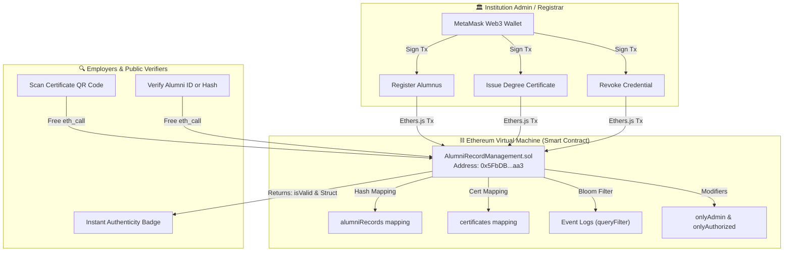

# 🎓 Alumnix: Alumni Record & Academic Credential Management System
### A Decentralized, General-Purpose Academic Credential Verification Platform Using Blockchain Technology
> **B.Tech 7th Semester Major Project** • Blockchain Technology & Ethereum Virtual Machine (EVM)

[](https://soliditylang.org/)
[](https://hardhat.org/)
[](https://docs.ethers.org/v6/)
[](https://react.dev/)
[](https://tailwindcss.com/)
[](https://ethereum.org/)

---

## 1. Project Overview

Academic fraud, counterfeit degrees, and slow manual background checks plague educational institutions and employers globally. 

**Alumnix** is an enterprise-grade, general-purpose **Alumni Record & Academic Credential Management System** built on Ethereum blockchain technology. It allows universities and colleges to:
- Register alumni identities with tamper-evident **Keccak-256** cryptographic hashes.
- Issue verifiable digital certificates complete with dynamic QR codes and downloadable high-resolution PDFs.
- Manage record lifecycles (**Active**, **Updated**, **Revoked**) on an immutable smart contract.
- Enable public verifiers, employers, and accreditation bodies to verify student credentials **in zero seconds for zero gas fees** without logging in.

---

## 2. Technology Stack & Architectural Rationale

| Layer | Technology | Rationale & Responsibility |
|---|---|---|
| **Smart Contract** | **Solidity 0.8.20** | Role-Based Access Control (`onlyAdmin`, `onlyAuthorized`), custom gas-efficient errors, immutable event logs, state machine. |
| **Blockchain Framework** | **Hardhat 2.22.x** | EVM development environment, local blockchain node with 20 test accounts (10,000 ETH each), automated unit testing suite, deployment scripts. |
| **Web3 Provider** | **Ethers.js v6.13** | Interfaces with MetaMask, signs EVM transactions, parses contract logs, computes Keccak-256 cryptographic hashes. |
| **Frontend Framework** | **React 18 & Vite** | Lightning-fast HMR development, clean component modularity, production-grade build. |
| **Styling & Design** | **Tailwind CSS** | Dark-mode SaaS aesthetics, glassmorphism, responsive data tables, accessible typography (Plus Jakarta Sans & JetBrains Mono). |
| **PDF Generation** | **jsPDF & html2canvas** | Client-side generation of landscape vector printable certificates with seals, signatures, and watermarks. |
| **QR Code Engine** | **qrcode.react** | Dynamic SVG QR codes linking physical certificates directly to the public verification portal. |
| **Storage Architecture** | **Hybrid On/Off-Chain** | Sensitive data kept private off-chain; cryptographic integrity hashes anchored on-chain. |

---

## 3. System Architecture Diagram



---

## 4. Key Application Pages

1. **Platform Landing Page (`/`):** Hero section, live on-chain counter statistics, interactive quick-verifier search box, architecture explainer, and feature breakdown.
2. **Admin Dashboard (`/admin`):** Institutional metrics, connected caller wallet balance and network badge, quick action shortcuts, recent registrations, and smart contract details.
3. **Alumni Directory (`/alumni`):** Responsive data table with multi-attribute search, department filter, status filter (Active, Updated, Revoked), sorting, registration modal, and update modal.
4. **Alumni Profile (`/alumni-profile`):** Student biographical overview, on-chain cryptographic proof card (Keccak-256 hash, block timestamp, wallet address), achievements, and issued certificates.
5. **Certificate Management (`/certificates`):** Issue degree certificates tied to registered alumni, preview certificates, filter valid vs. revoked, and trigger high-resolution PDF downloads.
6. **Public Record Authenticator (`/verify-record`):** Independent public portal to verify student credentials directly from smart contract state.
7. **Public Certificate Authenticator (`/verify-cert`):** Validates certificate authenticity via Certificate ID or camera QR code scan (`?id=CERT-XXXX`).
8. **Blockchain Explorer (`/transactions`):** Real-time EVM event logs displaying genuine Transaction Hashes, Block Numbers, Gas Consumed, and timestamps.
9. **Faculty Demonstration Guide (`/demo-guide`):** 5-minute presentation script and 25+ curated viva voce questions with model answers.

---

## 5. Quick Start & Execution Guide

### Prerequisites
- Node.js (v18+ or v24 LTS)
- npm (v9+)
- MetaMask extension installed in your web browser

### Step 1: Clone & Install Root Dependencies
```bash
git clone <repo-url>
cd "bct project"
npm install
```

### Step 2: Install Client Dependencies
```bash
cd client
npm install
cd ..
```

### Step 3: Run the Smart Contract Test Suite
Verify that all 14 unit test cases pass on the EVM:
```bash
npx hardhat test
```
*Expected Output:*
```
  AlumniRecordManagement Smart Contract
    1. Deployment & Administrative Setup
      ✔ should set the deployer as institution admin and authorized registrar
      ✔ should allow admin to authorize and revoke registrars
      ✔ should reject non-admin attempts to authorize registrars
    2. Alumni Registration
      ✔ should successfully register an alumnus and emit AlumniRegistered event
      ✔ should prevent duplicate alumni registration
      ✔ should reject registration from unauthorized users
    3. Record Updates & Integrity
      ✔ should allow authorized registrar to update record and reflect Updated status
    4. Alumni Revocation & Reinstatement
      ✔ should allow revoking an alumni record with reason and block verification
      ✔ should allow admin to reinstate a revoked record
    5. Certificate Issuance & Linking
      ✔ should issue a certificate linked to an alumnus
      ✔ should prevent duplicate certificate ID issuance
    6. Certificate Revocation & Verification
      ✔ should verify genuine active certificate as valid
      ✔ should revoke certificate and show invalid upon verification
    7. System Statistics Aggregation
      ✔ should return accurate aggregate statistics

  14 passing (1s)
```

### Step 4: Start Local EVM Blockchain Node
Open **Terminal 1**:
```bash
npm run node
```
*This starts a local Hardhat node at `http://127.0.0.1:8545` with 20 pre-funded test accounts (10,000 ETH each).*

### Step 5: Deploy & Seed Smart Contract
Open **Terminal 2**:
```bash
npm run deploy:local
```
*This compiles the contract, deploys `AlumniRecordManagement.sol`, seeds demo alumni & certificates on-chain, and automatically exports the ABI and contract address to `client/src/contracts/AlumniRecordManagement.json`.*

### Step 6: Launch the Client Application
Open **Terminal 3**:
```bash
npm run client
```
*Open your browser and navigate to:* **`http://localhost:3000`**

---

## 6. MetaMask Setup for Demonstration

1. In MetaMask, add the **Hardhat Localhost** network:
   - **RPC URL:** `http://127.0.0.1:8545`
   - **Chain ID:** `31337`
   - **Currency Symbol:** `ETH`
2. Import the Institution Admin pre-funded account:
   - **Private Key:** `0xac0974bec39a17e36ba4a6b4d238ff944bacb478cbed5efcae784d7bf4f2ff80`
   - **Balance:** `10,000 ETH`
3. Connect your wallet via the **Connect MetaMask** button in the top navigation bar.

---

## 7. Project Documentation Index

- [`docs/ARCHITECTURE.md`](docs/ARCHITECTURE.md): Deep-dive into Keccak-256 integrity, data models, state machines, and gas optimization.
- [`docs/DEPLOYMENT_GUIDE.md`](docs/DEPLOYMENT_GUIDE.md): Detailed local & Sepolia testnet deployment instructions.
- [`docs/FACULTY_DEMO_SCRIPT.md`](docs/FACULTY_DEMO_SCRIPT.md): 5-minute timed presentation walkthrough for academic examiners.
- [`docs/VIVA_QUESTIONS_ANSWERS.md`](docs/VIVA_QUESTIONS_ANSWERS.md): 25+ curated viva voce questions with concise explanations.

---

## 8. License

This project is released under the **MIT License**. Suitable for academic, research, and non-commercial institutional adoption.

