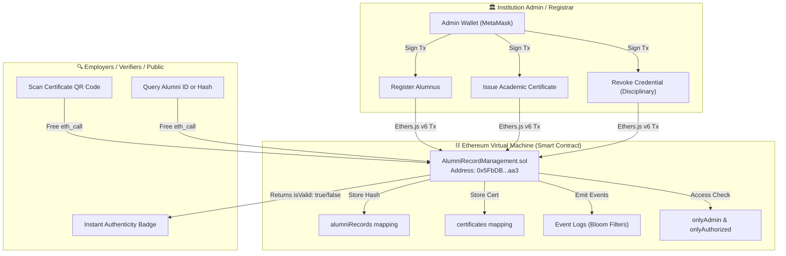
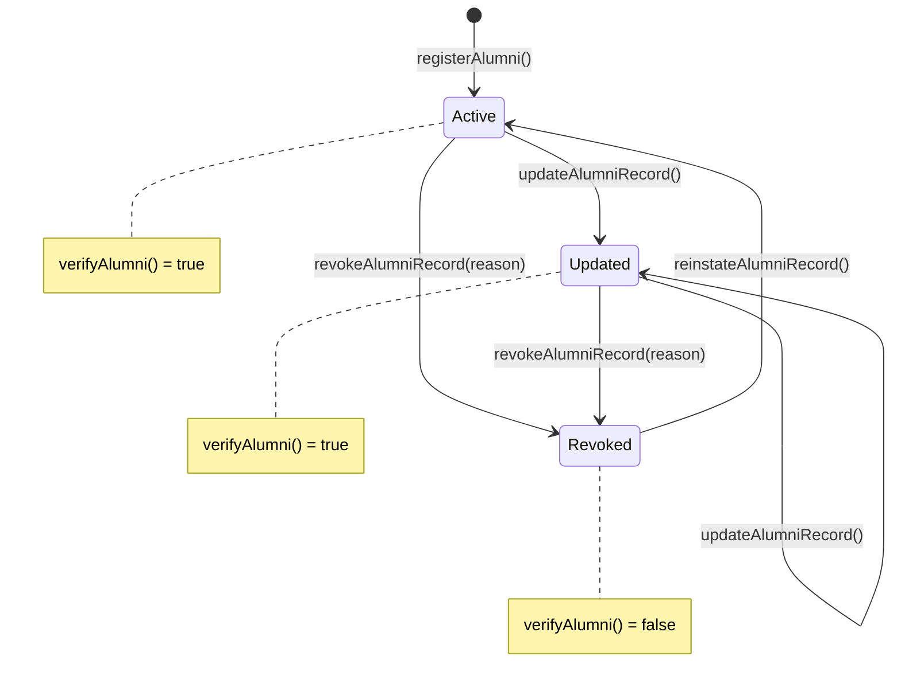

# System Architecture & Technical Specifications
## Alumni Record Management System Using Blockchain Technology

---

## 1. Executive Summary & Design Philosophy

The **Alumni Record Management System** is a decentralized, general-purpose academic credential platform engineered for higher education institutions. The system addresses the widespread challenges of degree counterfeit, administrative credential fraud, and inefficient manual verification procedures.

### Core Architectural Axiom: Hybrid On-Chain / Off-Chain Design
* **On-Chain (Ethereum Virtual Machine - EVM):**
  - Cryptographic digital footprints (`keccak256` data hashes)
  - Canonical identifiers (`alumniId`, `certificateId`)
  - Authority governance & Role-Based Access Control (`institutionAdmin`, `isAuthorizedRegistrar`)
  - Status state machine (`Active`, `Updated`, `Revoked`)
  - Auditable transaction logs & historical event emissions
* **Off-Chain (Browser Client & Institutional Storage):**
  - Rich student biographical details (photographs, transcript grades, contact details)
  - Vector PDF certificate templates & dynamic QR-code payloads
  - Preserves student privacy, satisfies GDPR / data protection mandates, and saves thousands of dollars in blockchain gas storage fees.

---

## 2. High-Level Architectural Flowchart



---

## 3. Cryptographic Tamper-Proofing Layer

Credential verification relies on the mathematical properties of the **Keccak-256** hash function:

$$\text{DataHash} = \text{keccak256}(\text{AlumniId} \parallel \text{Name} \parallel \text{Degree} \parallel \text{Department} \parallel \text{GraduationYear} \parallel \text{CGPA})$$

$$\text{CertHash} = \text{keccak256}(\text{CertificateId} \parallel \text{AlumniId} \parallel \text{Title} \parallel \text{Grade} \parallel \text{Timestamp})$$

### Tamper-Detection Sequence:
1. When an alumnus presents an academic certificate or transcript to an employer, the employer loads the record on the Public Verifier.
2. The verification engine recalculates $\text{keccak256}(\text{OffChainPayload})$.
3. The computed hash is compared directly with `record.dataHash` read from the smart contract.
4. **Result:** If even a single grade point or letter was modified, the hash differs completely (avalanche effect), flagging the credential as forged.

---

## 4. Smart Contract State Machine



### Certificate State Machine
- `issueCertificate()` $\rightarrow$ Certificate `exists = true`, `isRevoked = false`.
- `revokeCertificate()` $\rightarrow$ Sets `isRevoked = true` with reason.
- `verifyCertificate()` returns:
  $$\text{isValid} = \text{cert.exists} \land \neg \text{cert.isRevoked}$$

---

## 5. Gas Optimization Strategy

The smart contract `AlumniRecordManagement.sol` utilizes several Solidity 0.8.20 best practices:
1. **Custom Errors:**
   ```solidity
   error NotAuthorized();
   error AlumniAlreadyExists(string alumniId);
   error AlumniNotFound(string alumniId);
   ```
   Replaces verbose revert strings, reducing bytecode deployment size and runtime execution gas.
2. **View Execution:**
   Public verifier calls (`verifyAlumni`, `verifyCertificate`, `getSystemStatistics`) are marked `view`, meaning verifiers query local RPC nodes via `eth_call` without paying gas or requiring cryptocurrency.
3. **Calldata Parameters:**
   All external string inputs use `calldata` instead of `memory` to prevent unnecessary memory allocations during contract execution.

